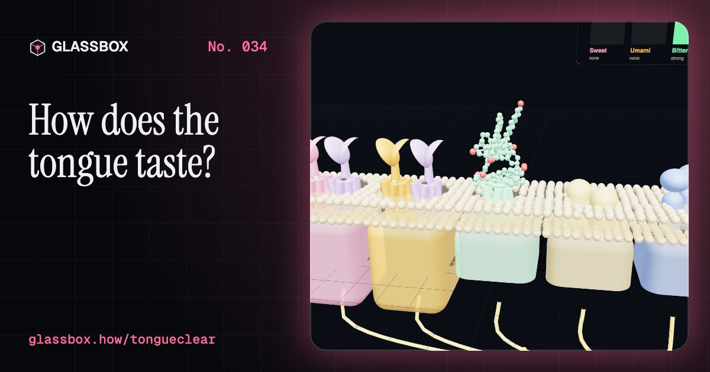
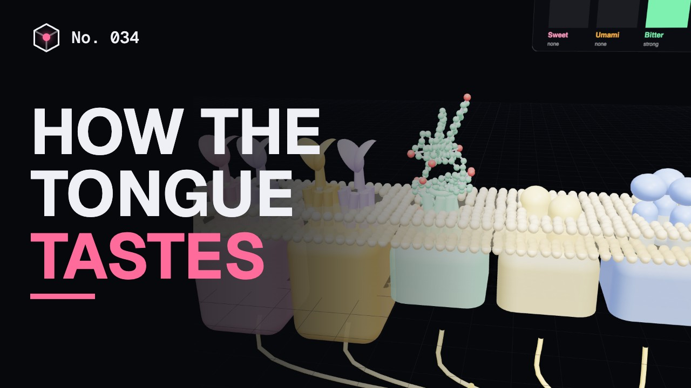
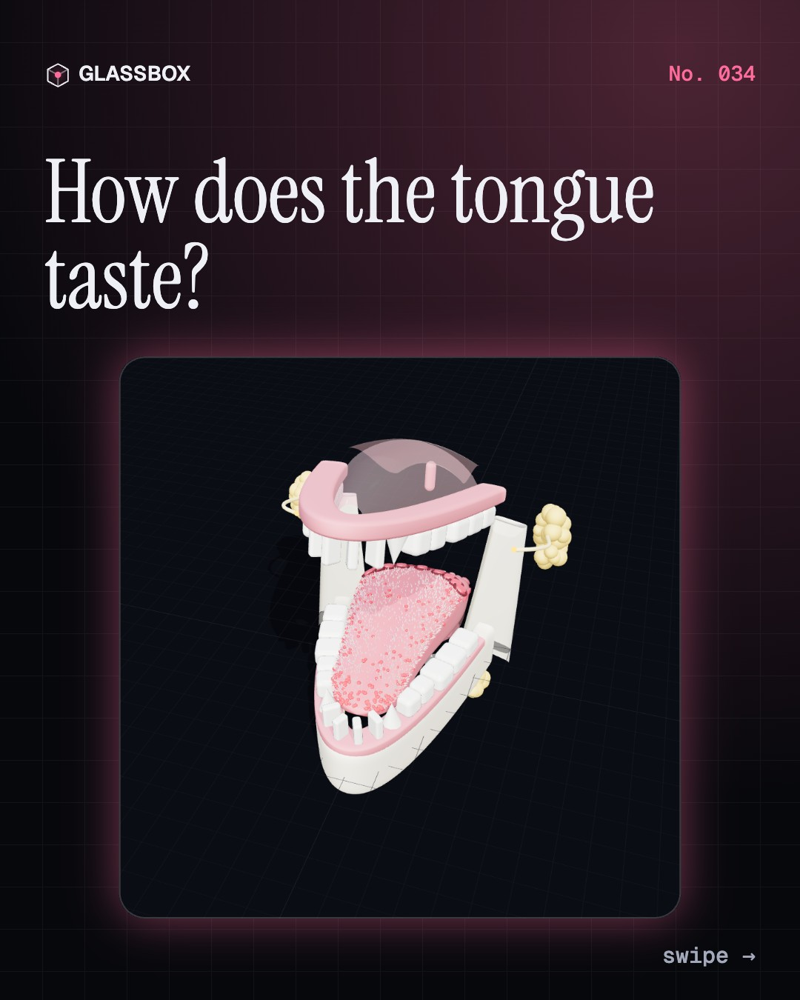
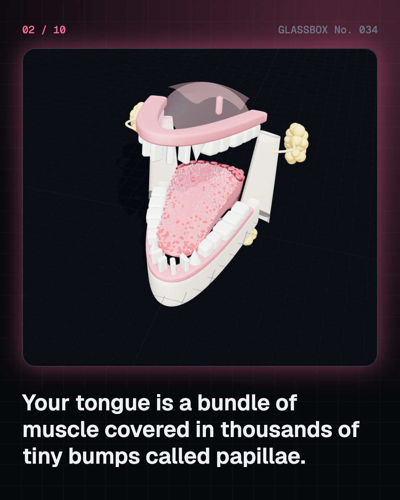
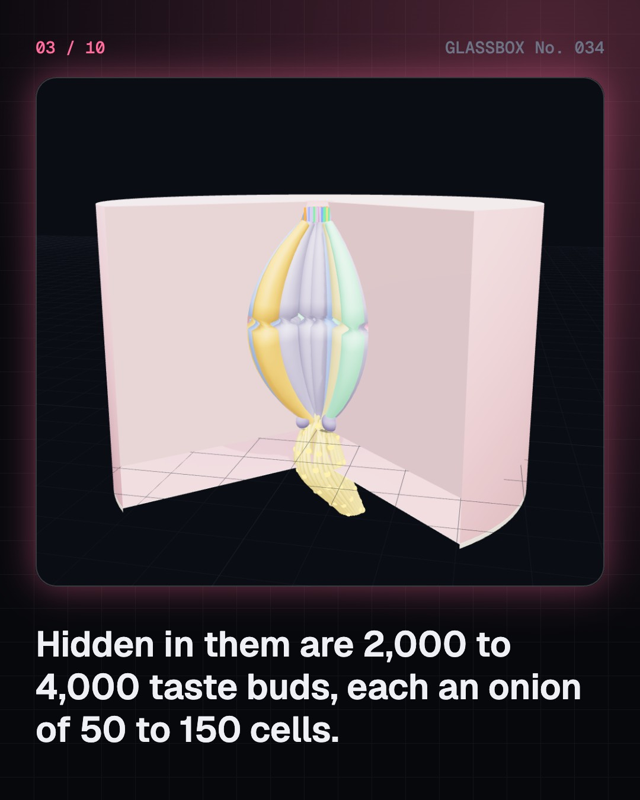
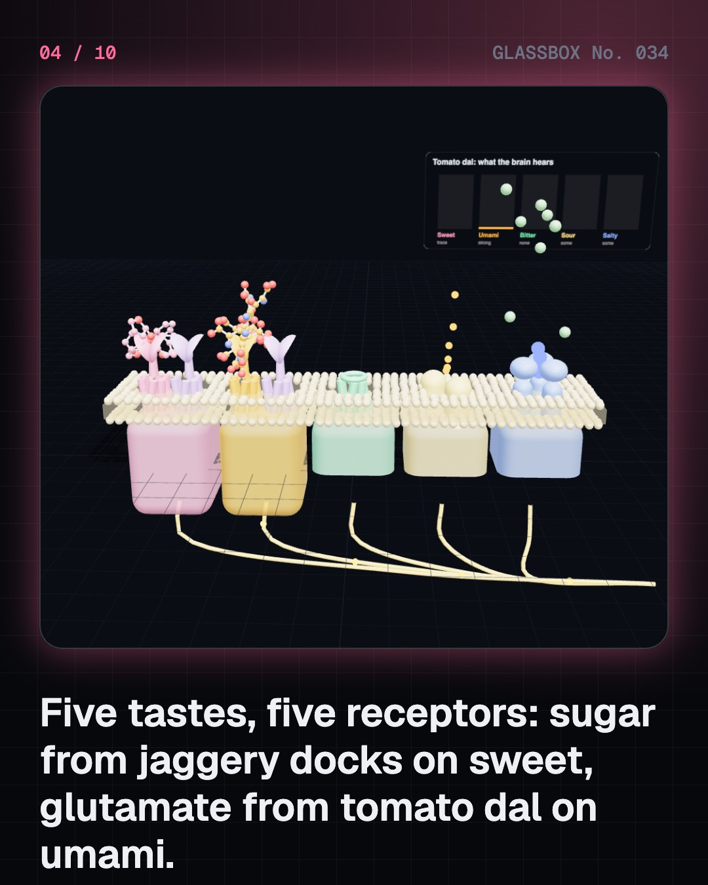

<!-- glassbox:start -->
<!-- Generated from glassbox.json by the Glassbox hub (npm run readme -- tongueclear). Edit glassbox.json, not this block. -->
<p align="center"><a href="https://glassbox-production-fd52.up.railway.app/e/tongueclear/"></a></p>

<h1 align="center">TongueClear</h1>

<p align="center"><b>How does the tongue taste?</b><br>The tongue map in your school book is a myth, chilli heat is not a taste at all, and most of what you call flavour is really smell. Open up a 3D mouth, watch sugar, salt and glutamate dock on their receptors, and see why milk beats water after a bhut jolokia.</p>

<p align="center"><a href="https://glassbox-production-fd52.up.railway.app/tongueclear/"><b>▶ Play with it</b></a> &nbsp;·&nbsp; <a href="https://glassbox-production-fd52.up.railway.app/e/tongueclear/">Read the 60-second explainer</a> &nbsp;·&nbsp; <a href="https://glassbox-production-fd52.up.railway.app/tongueclear/glassbox/reel.mp4">Watch the 40-second video</a></p>

<p align="center">
  <a href="https://glassbox-production-fd52.up.railway.app/e/tongueclear/"></a>
  <a href="https://glassbox-production-fd52.up.railway.app/e/tongueclear/"></a>
  <a href="LICENSE"></a>
  <a href="LICENSE-CONTENT.md"></a>
  <a href="#privacy"></a>
</p>

## In 60 seconds

1. **A muscle covered in taste buds.** The tongue is all muscle and no bone, moved by eight pairs of muscles. Its top is covered in papillae: filiform spikes for touch, and fungiform, foliate and circumvallate papillae that hide about 2,000 to 4,000 taste buds, each an onion of 50 to 150 cells.
2. **Five tastes, five receptors.** Sweet sugars clamp onto T1R2 + T1R3; umami glutamate onto T1R1 + T1R3. About 25 T2R receptors catch bitter, a warning sense. Sour protons flow in through the OTOP1 channel and salty sodium through ENaC. The brain reads the pattern across all five.
3. **The tongue map is a myth.** A 1901 study found small differences in sensitivity around the tongue's edge. A 1942 redrawing was misread as sweet only on the tip and bitter only at the back. Every area with taste buds senses all five; the middle is weaker only because it has few buds.
4. **Chilli heat is pain.** Capsaicin opens TRPV1, a heat sensor on nerve endings that normally opens above about 43 °C, so chilli feels hot. Menthol opens TRPM8, the cold sensor. The bhut jolokia passed a million Scoville units in 2007; milk and curd wash the oily capsaicin away far better than water.
5. **Flavour is mostly smell.** As you chew and breathe out, aroma flows from the back of the mouth up into the nose. Hold your nose and mango shrinks to sweet and a bit sour. Taste also needs saliva, and supertasters find some bitter chemicals far stronger.
6. **Always renewing.** Taste cells last about ten days on average and are replaced by stem cells, which is why a tongue scalded by hot tea usually recovers. Age, smoking, colds, COVID-19, medicines and a dry mouth can change taste; if it changes suddenly or does not come back, see a doctor.

## Words worth knowing

| Term | Meaning |
|---|---|
| **Taste bud** | An onion-shaped cluster of about 50 to 150 cells that detect taste chemicals dissolved in saliva. |
| **Papillae** | The small bumps on the tongue; filiform papillae sense touch, the other three kinds carry taste buds. |
| **Receptor** | A protein on a cell that catches one kind of chemical and switches the cell on. |
| **Umami** | The savoury taste of glutamate, found in tomatoes, dal, broth and cheese; named by Kikunae Ikeda in 1908. |
| **Ion channel** | A protein doorway in a cell’s skin; sour (OTOP1) and salty (ENaC) tastes work through channels. |
| **TRPV1** | A heat and pain sensor on nerve endings that opens above about 43 °C and with capsaicin from chillies. |
| **Scoville heat unit** | A measure of chilli heat; pure capsaicin is about 16 million SHU. |
| **Retronasal smell** | Smelling food from inside the mouth as air flows up into the nose; most of flavour. |
| **Supertaster** | A person who finds certain bitter chemicals, like PROP, very intense; about a quarter of people. |

## A short history

**From Aristotle and the six rasas of Ayurveda to a myth-making tongue map, the discovery of umami, and receptors for every taste.**

- **350 BCE** · Aristotle lists the tastes (Aristotle, Athens, Greece)
- **100 BCE** · Ayurveda names six rasas (The Charaka Samhita (compiled by physicians in the tradition of Agnivesha and Charaka), Ancient India)
- **1901** · Hänig measures the edge of the tongue (David P. Hänig, Leipzig, Germany)
- **1908** · Ikeda finds umami in kombu (Kikunae Ikeda, Tokyo Imperial University, Japan)
- **1912** · Scoville measures chilli heat (Wilbur Scoville, Detroit, USA)
- **1931** · The chemical some people cannot taste (Arthur Fox, DuPont laboratory, Wilmington, USA)
- **1974** · The tongue map is tested and fails (Virginia B. Collings, University of Pittsburgh, USA)
- **2001** · Sweet and umami receptors are pinned down (Greg Nelson, Charles Zuker, Nicholas Ryba and others, USA)

The full story, with 26 moments, charts, people and 46 sources: [glassbox.how/e/tongueclear/history](https://glassbox-production-fd52.up.railway.app/e/tongueclear/history/). The data lives in [`history.json`](history.json).

## Video and slides

Made with the Glassbox studio from this box's storyboard (`window.glassbox.director`). Free to reuse under CC BY 4.0.

<a href="https://glassbox-production-fd52.up.railway.app/tongueclear/glassbox/video.mp4"></a>

<p><a href="glassbox/slide-1.jpg"></a> <a href="glassbox/slide-2.jpg"></a> <a href="glassbox/slide-3.jpg"></a> <a href="glassbox/slide-4.jpg"></a></p>

| File | What | Size |
|---|---|---|
| [`glassbox/reel.mp4`](https://glassbox-production-fd52.up.railway.app/tongueclear/glassbox/reel.mp4) | Reel / Short, with captions and soundtrack | 1080×1920 |
| [`glassbox/video.mp4`](https://glassbox-production-fd52.up.railway.app/tongueclear/glassbox/video.mp4) | YouTube video, with captions and soundtrack | 1920×1080 |
| `glassbox/slide-1…10.jpg` | Instagram carousel | 1080×1350 |
| `glassbox/thumb.jpg` | YouTube thumbnail | 1280×720 |
| `glassbox/cover.jpg` | Share card and repo social preview | 1200×630 |
| [`glassbox/history-reel.mp4`](https://glassbox-production-fd52.up.railway.app/tongueclear/glassbox/history-reel.mp4) | “History in 10 moments” Reel / Short | 1080×1920 |
| `glassbox/history-slide-*.jpg` | History carousel | 1080×1350 |
| `glassbox/post.json` | Post copy and schedule used by the publish kit | |

## Privacy

This box has no accounts and no ads, and it ships its own fonts and libraries. When you run it yourself it sends nothing anywhere. On glassbox.how, the site's `/bar.js` also loads Glassbox's analytics: **Google Analytics** to count visits (it asks first in the EU, UK and Switzerland, and stays off when your browser sends Global Privacy Control or Do Not Track) and **ClickTrust** to detect bots.

It remembers a few things **in your own browser only**, and never sends them anywhere:

| Browser storage key | What it holds |
|---|---|
| `tongueclear.v1` | Which chapters you have opened, your best quiz scores, and sound on or off. |

Exactly what each one sees is at [glassbox.how/privacy](https://glassbox-production-fd52.up.railway.app/privacy/).

## Licences

- **Code:** [MIT](LICENSE). Use it, change it, ship it.
- **Explanations, text, images and videos** (`glassbox.json`, `glassbox/`): [CC BY 4.0](LICENSE-CONTENT.md). Credit “Glassbox, glassbox.how/e/tongueclear”.
- **Third-party parts** keep their own licences: [three.js](https://threejs.org) (MIT), [Geist, Instrument Serif](https://openfontlicense.org) (SIL OFL 1.1).
- The Glassbox name and logo aren't covered by either licence. See the [terms](https://glassbox-production-fd52.up.railway.app/terms/).

Found a mistake? [Open an issue](https://github.com/bdeeps/tongueclear/issues). Corrections happen in public.
<!-- glassbox:end -->

## Run it

It's plain HTML, CSS and JavaScript. No build step and no dependencies. Run locally, it contacts no other website.

```bash
python3 -m http.server 8000
```

Three.js and the fonts ship in `vendor/` and `fonts/`, so it also works offline.

Then open http://localhost:8000.

## How it's built

| File | What |
|---|---|
| `index.html`, `css/app.css` | The page and its styles |
| `js/app.js`, `js/stage.js`, `js/ui.js`, `js/kit.js` | The shared Glassbox 3D engine: chapters, 3D stage, controls, quiz, video director |
| `js/chapters/*.js` | One file per chapter: the 3D model, controls, text, key terms, quiz and video scenes |
| `js/tongue.js` | The 3D mouth: a tongue surface with its four kinds of papillae, the muscles and nerves, teeth, palate, epiglottis and salivary glands, plus shared helpers |
| `js/cells.js` | The small-scale models: a taste bud cut open, the four papillae, a membrane with taste receptors and TRP channels, and ball-and-stick molecules |
| `js/head.js` | A side view of the head cut down the middle, for smell and flavour and for how the tongue moves |
| `js/taste.js` | The science and numbers: the five tastes and their receptors, foods, thresholds, the Scoville scale and TRPV1/TRPM8, with sources |
| `glassbox.json` | Title, question, explainer beats, key terms, browser storage and credits shown on glassbox.how |
| `reel` in each chapter | The storyboard the Glassbox studio records into short videos |
| `glassbox/` | The published video, slides, thumbnail and post copy |
| `fonts/`, `vendor/three/` | Self-hosted Geist and Instrument Serif (SIL OFL 1.1) and three.js (MIT) |
